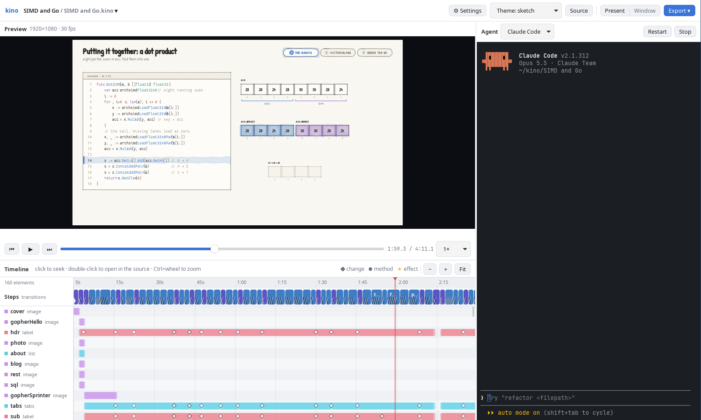

# Kino

**Technical slides written as text, where every change animates.**

Write your talk in a plain text file. Each slide, and each change on a slide, is
animated for you: code lines slide to their new place, arrays sort themselves,
arrows follow what they point at. Present it from the desktop app, share it as
an HTML presentation or a PDF, or turn the same file into a narrated video.

Kino is built for technical talks: code, data structures, memory, CPU
registers, algorithms, architecture diagrams.



## Why Kino

- **Text, not drag-and-drop.** A talk is one `.kino` file you can diff, review
  and keep in git next to your code.
- **Animations for free.** You describe what each slide looks like; Kino works
  out the motion between them.
- **Made for technical content.** Code blocks, arrays, structs, tables, trees,
  memory, bits, registers and arrows are built in.
- **Your AI agent can write it.** Kino Studio has a terminal for Claude Code,
  Codex or Gemini CLI, and they already know the language.
- **One file, many outputs.** Present live, export an HTML presentation or a
  PDF, or render a video with an AI voice.

## Try it

You need Node.js and Go, plus a few system packages on Linux (see
[Install](#install) for the exact list). Then:

```sh
git clone https://github.com/jespino/kino.git
cd kino
make run
```

`make run` builds Kino Studio and opens it straight from the repo. Pick one of
the examples on the welcome screen and press **Present**.

## Your first deck

Save this as `talk.kino`:

```kino
video { theme: sketch }

frame "Cover" {
  cover: title at center() { eyebrow: "Tech talk", text: "How sorting works", subtitle: "a slide deck in one text file" }
}

frame "The idea" (fade) {
  heading: label at (100, 80) { text: "Sorting in three moves", size: 48, weight: 700 }
  points: list at (100, 200) { items: ["Compare two neighbours"], bullet: number, size: 32 }
}

step {
  points.push("Swap them if they're out of order")
}

step {
  points.push("Repeat until nothing moves")
}

frame "Demo" (fade) {
  heading: label at (100, 80) { text: "Let's try it", size: 48, weight: 700 }
  nums: array at center() { values: [5, 2, 8, 1], cell: 100, size: 40 }
}

step "Sorted" {
  nums.sort()
  heading.text = "Sorted!"
}
```

Open it with `make run PROJECT=talk.kino` (or `kino talk.kino` after
`make install`) and press **Present**. Each click moves forward one step:

1. The title card draws itself in.
2. "The idea" fades in with the first bullet; the next two clicks add one
   bullet each.
3. "Demo" fades in with an array; the last click sorts it, and the numbers
   slide into place while the heading changes.

How the file works:

- `frame` starts a **new slide**. Anything not declared in it disappears.
  Things with the same name on both slides (like `heading`) morph from one to
  the other instead.
- `step` is a **build** on the current slide: one click's worth of change.
  You write what changes (`nums.sort()`), and Kino animates it.
- `video { ... }` holds settings for the whole deck, like the theme.

A few more things you'll use soon:

- `then` inside a step splits it into several animations that play one after
  another (in Present mode, each one is its own click).
- `a -> b` draws an arrow that follows both ends when they move.
- `group` moves several things as one: `cluster.at = (600, 200)`.
- `chart` draws bar, line and pie charts that animate when the numbers change.
- Text can mix styles: `"**bold**, *italic*, `code` and {good: color}"`.
- Between sections, a slide can `wipe`, `iris`, `slide` or `push` in:
  `frame "Part 2" (push) { ... }`.
- `code` blocks animate edits: change the code and unchanged lines slide to
  their new place.

The [examples](#examples) show much more, and every widget and option is in the
[language reference](docs/DSL.md).

## Install

`make run` is enough to try Kino. To install Kino Studio as a regular app,
first install these tools:

- [Node.js](https://nodejs.org/) (a current LTS release)
- [Go](https://go.dev/dl/)
- **Linux only:** a C compiler and the GTK/WebKit development packages:

  ```sh
  sudo apt install build-essential pkg-config libgtk-3-dev libwebkit2gtk-4.1-dev   # Debian/Ubuntu
  sudo dnf install gcc pkgconf-pkg-config gtk3-devel webkit2gtk4.1-devel           # Fedora
  sudo pacman -S base-devel pkgconf gtk3 webkit2gtk-4.1                            # Arch
  ```

- **macOS only:** the Xcode command line tools (`xcode-select --install`)
- Optional: [ffmpeg](https://ffmpeg.org/), to render videos from the command line

Then, in the repo folder:

```sh
make install
```

It installs Kino Studio for your user (no `sudo`):

- **Linux:** it appears in your applications menu, and `kino` works from a
  terminal (installed in `~/.local/bin`).
- **macOS:** `kino.app` goes to `~/Applications`.

If something is missing, `make run` and `make install` tell you what to install.
`make uninstall` removes the app again; your projects and settings stay.

## Presenting

Press **Present** to show the deck fullscreen, or **Window** to fill the app
window instead (handy when you share a single window in a video call).
Presenting starts from where you are in the deck.

Each click or key press plays one animation (a slide, a step or a `then`) and
stops. Pressing again during an animation finishes it.

| Key | Action |
|---|---|
| click, Space, →, ↓, Enter, PageDown | next |
| ←, ↑, Backspace, PageUp, right-click | back |
| `]` / `[` | next / previous whole step |
| Home / End | first / last |
| `f` | switch between fullscreen and window |
| `s` | open the speaker view |
| Esc | leave (the studio jumps to where you were) |

**Speaker view.** Press `s` (or **Speaker** in the toolbar) for a second
window with the current and next slide, your notes and a timer. Put it on
your laptop screen and the slides on the projector. Notes go in the script:

```kino
step {
  note "Pause here: ask who has used zstd."
  nums.sort()
}
```

**Links.** Give anything a `link` and clicking it while presenting jumps to
that slide: `link: "Demo"` (the name of a `frame` or `step`), or a web
address. With the `zoom-in` transition you can build a Prezi-style deck: an
overview slide whose boxes link to their topics, and each topic flies out of
its box (`frame "Storage" (zoom-in, target: sto) { ... }`). Linking back to the
overview zooms back out.

## Sharing your slides

From the studio's **Export** menu:

- **Presentation (HTML):** one self-contained file that presents in any
  browser, even offline. It works like Present mode: click or Space for the
  next step, `f` for fullscreen, `s` for the speaker view, links work, and
  `#slide=3` at the end of the URL opens slide 3.
- **Slides (PDF):** one page per step and per `then`, exactly as they look when
  presenting.
- **Video (MP4):** the whole deck as a video, with narration if it has any (see
  [Turning slides into a video](#turning-slides-into-a-video)).
- **Current frame (SVG):** the picture you're looking at.

From the command line (after `npm install`):

```sh
npm run render -- talk.kino -o out/talk.pdf
```

## Kino Studio

Kino Studio is the desktop app where you write, preview and present a deck:

- **Preview** (top left): the deck as it plays. The **Source** panel (Ctrl+2)
  next to it edits the file and saves as you type.
- **Timeline** (bottom): every slide and step, and every element on them, as
  tracks. Click to jump there; double-click to open that line in the source;
  Ctrl+wheel to zoom.
- **Agent** (right): a terminal running your coding agent (Claude Code, Codex,
  Gemini CLI, Antigravity) or a plain shell, in the project folder.

The studio reloads whenever the file changes on disk, so edits from your agent
or your editor show up right away. If the file has an error, the last working
version stays on screen and the error points at its line.

**Shortcuts:** Space plays or pauses, ←/→ jumps between steps, Ctrl+Enter plays
from the step under the cursor. Click an error to jump to its line.

**Opening it:** `make run` from the repo (add `PROJECT=path/to/talk.kino` to
open a deck), or, after `make install`, from your applications menu or with
`kino [deck.kino or folder]`.

**Projects:** a project is a folder with one `.kino` file plus the pictures it
uses. Start a new one from the welcome screen, empty or from a template. The
examples are built-in templates, and you can add your own to
`~/.kino/templates` (a `<name>.kino` file, or a `<name>/` folder with the file
and its pictures).

## Writing slides with an AI agent

The repo includes a Claude Code skill (`.claude/skills/kino/SKILL.md`) that
teaches Claude the whole language and how to check its work. Ask for a deck,
for example *"make a kino deck explaining how hash maps resize"*, and Claude
writes the `.kino` file, checks it and looks at every slide. You can also run it
with `/kino`.

When you start an agent inside Kino Studio, the studio gives it the same
knowledge automatically (it writes `AGENTS.md`, the language reference and the
skill into the project).

## Themes

| Theme | Look |
|---|---|
| `neon` (default) | Dark navy with glowing cyan and pink accents |
| `sketch` | Pencil and watercolor on paper, handwritten text |
| `comic` | Comic book: ink outlines, halftone dots, bold lettering |
| `blueprint` | White line work on blue paper with a grid |
| `whiteboard` | Marker doodles on a whiteboard |
| `pixel` | 8-bit pixel art |
| `paper-cut` | Layers of hand-cut paper with soft shadows |
| `dark`, `light` | Plain and flat |

Pick one with `video { theme: sketch }` in the file or the theme menu in the
studio. You can also change single colors and fonts, or add your own footer
and side bars for a company template:
`video { theme: { base: light, accent: "#c0392b", footerLeft: "ACME" } }`.
[docs/THEMES.md](docs/THEMES.md) has all the details.

## Examples

Each one is a `.kino` file in [`examples/`](examples), and each is also a
template in Kino Studio's welcome screen.

| Example | Shows |
|---|---|
| [`go-slices.kino`](examples/go-slices.kino) | How Go slices work: a header pointing into a backing array |
| [`code-morph.kino`](examples/code-morph.kino) | Code lines sliding to their new place after a change |
| [`bubble-sort.kino`](examples/bubble-sort.kino) | Pointers moving along an array while values swap |
| [`registers.kino`](examples/registers.kino) | What a CPU does to run `add`: registers, C source, disassembly |
| [`simd-avx.kino`](examples/simd-avx.kino) | SIMD instructions on 256-bit registers |
| [`bits-bytes-trees.kino`](examples/bits-bytes-trees.kino) | Float encoding, struct memory layout, a binary search tree |
| [`columnar-compression.kino`](examples/columnar-compression.kino) | How log rows become compressed columns (with narration) |
| [`tables-and-grids.kino`](examples/tables-and-grids.kino) | Sorting tables, highlighting matrices, camera moves |
| [`ui-walkthrough.kino`](examples/ui-walkthrough.kino) | A cursor clicking a button and a checklist updating |
| [`system-tour.kino`](examples/system-tour.kino) | A Prezi-style tour: an overview whose boxes zoom into their topics, charts, speaker notes |
| [`emoji-fun.kino`](examples/emoji-fun.kino) | Emoji and emphasis effects (bounce, shake, spin...) |
| [`custom-widget.kino`](examples/custom-widget.kino) | Using a widget you wrote yourself |

## Turning slides into a video

The same file can become a video: steps play one after another with short
pauses, and `say "..."` lines add a spoken narration.

```kino
step "Sorted" {
  nums.sort()
}
say "And now the numbers are in order."
```

In Present mode and in the HTML and PDF exports, narration is skipped, so you
can talk over the slides yourself.

**Rendering** needs [ffmpeg](https://ffmpeg.org/) and `npm install`:

```sh
npm run render -- talk.kino -o out/talk.mp4      # also .webm and .gif
```

Or use **Export → Video (MP4)** in the studio.

**Voices:** by default narration uses
[Kitten TTS 2](https://github.com/KittenML/KittenTTS), running on your machine
(on the GPU if you have one): 47 voices, 20 languages, emotion tags like
`[joyful]` and `<laugh>`, and voice cloning from a short recording. Set it up
once, then start the voice server whenever you work with narration:

```sh
npm run tts:setup      # once: installs Python 3.12, torch and the model into tts/.venv
npm run tts            # starts the server (the first run downloads ~1 GB)
```

The studio generates missing voice clips when you press Play; `npm run render`
adds them to the video (`--no-audio` skips them). Each project can use
ElevenLabs or OpenAI (hosted), or espeak-ng or festival (local) instead: choose
one in the studio under **Settings → This project**, and enter API keys under
**Settings → Kino**. See [Narration providers](docs/DSL.md#narration-providers).

<details>
<summary>More narration details</summary>

- Clips are cached in `.kino-cache/tts/<hash>.wav`, keyed by the text and all
  voice settings. The CLI and the studio share the cache. Delete a file to
  regenerate that line.
- `--tts <url>` (CLI) or `KINO_TTS_URL` points at another server;
  `KINO_CACHE` moves the cache.
- `npm run tts -- --device cpu` forces the CPU.
- Qwen3-TTS models work too: run `tts/setup.sh --with-qwen`, then set
  `voice: { model: "Qwen/Qwen3-TTS-12Hz-0.6B-CustomVoice", speaker: Ryan }`.
- Project settings are saved as `kino.json` next to the script; app settings
  in `~/.config/kino/config.json`.

</details>

## Command line

Run `npm install` once. Then:

| Command | What it does |
|---|---|
| `npm run check -- talk.kino` | Find errors (with line numbers) and list the steps |
| `npm run check -- talk.kino --sheet out/sheet.png` | One picture with every step and sub-step, to review the whole deck at a glance |
| `npm run render -- talk.kino -o out/talk.pdf` | Slides as a PDF |
| `npm run render -- talk.kino -o out/talk.mp4` | A video (`.mp4`, `.webm` or `.gif`; needs ffmpeg) |
| `npm run render -- talk.kino --png out/slide.png --at 3.5s` | One picture at a point in time |
| `npm run render -- talk.kino --theme comic -o out/talk.pdf` | Use another theme |
| `npm test` | Run the test suite |

The `Makefile` has shortcuts for these; run `make` to list them.

## Learn more

- [docs/DSL.md](docs/DSL.md): the full language, every widget and its options.
  The built-in widgets are `label`, `box`, `circle`, `button`, `array`,
  `struct`, `matrix`, `table`, `list`, `code`, `tabs`, `title`, `emoji`,
  `image`, `merge`, `tree`, `memory`, `bits`, `arrow`, `pointer`, `cursor`,
  `callout`, `brace`, `spotlight` and `camera`.
- [docs/THEMES.md](docs/THEMES.md): themes, every theme setting, fonts.
- [docs/DEVELOPMENT.md](docs/DEVELOPMENT.md): how Kino works inside, the code
  layout, writing your own widgets, and current limitations.

## License and credits

Kino is released under the [MIT license](LICENSE).

- Fonts: [Inter](https://rsms.me/inter/), [JetBrains Mono](https://www.jetbrains.com/lp/mono/), [Patrick Hand](https://fonts.google.com/specimen/Patrick+Hand) (Patrick Wagesreiter; extended as Kino Hand), [Lato](https://www.latofonts.com/) (Łukasz Dziedzic), [Fantasque Sans Mono](https://github.com/belluzj/fantasque-sans) (Jany Belluz), [Bangers](https://github.com/googlefonts/bangers) (Vernon Adams), [Comic Neue](https://github.com/crozynski/comicneue) (Craig Rozynski), [Press Start 2P](https://fonts.google.com/specimen/Press+Start+2P) (Cody "CodeMan38" Boisclair), [VT323](https://fonts.google.com/specimen/VT323) (Peter Hull) and [Fredoka](https://github.com/hafontia-zz/Fredoka) (Milena Brandão; static instances cut from the variable font), SIL Open Font License.
- Emoji artwork: [Twemoji](https://github.com/jdecked/twemoji) (`@twemoji/svg`). Graphics are licensed CC-BY 4.0; credit Twemoji when you publish slides or videos that use them.
